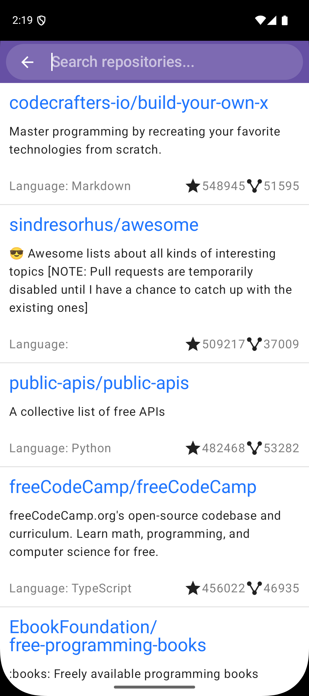
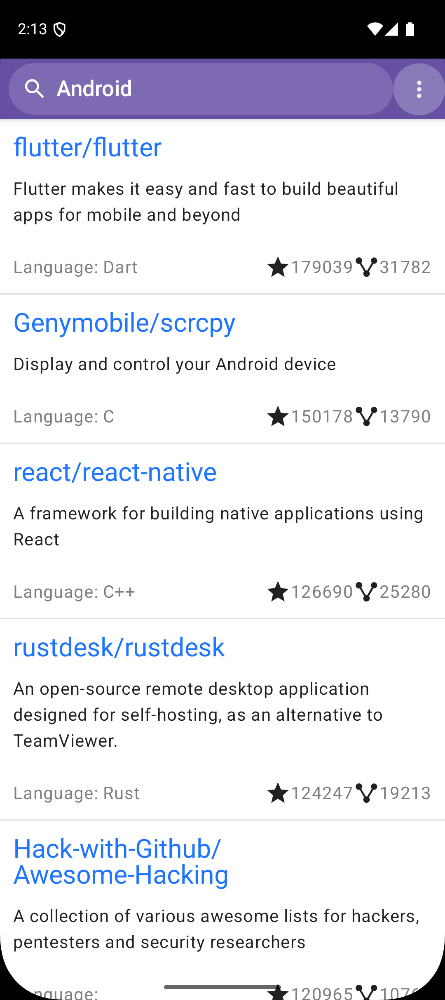
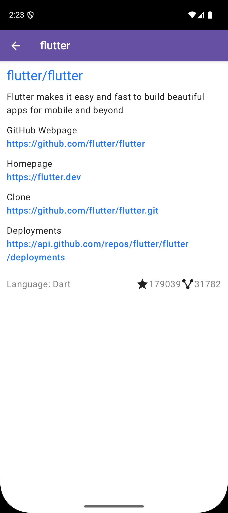

# GithubRepos

Sample application written using Kotlin Multiplatform and Compose Multiplatform. It allows users to search for specific GitHub repositories and displays the results as a paginated list. Clicking on an item displays a screen with detailed information about the selected repository.

The application runs on `Android`, `iOS`, `JVM`, and `Wasm`.

<table>
  <tr>
    <td>
      
    </td>
    <td>
      
    </td>
    <td>
      
    </td>
  </tr>
</table>

## Flavors

The application can be compiled in two different flavors: **Demo** and **Full**.
- **Full** — downloads the list of GitHub repositories from GitHub.
- **Demo** — uses a built-in sample list of 50 GitHub repositories.

## Running the app

Run configurations for each platform are available in the `.idea/runConfigurations directory`.

## Architecture 

The application is inspired by Clean Architecture. The code is vertically divided into modules organized into the **core**, **adapter**, and **framework** layers. Each layer consists of several modules.

Modules in higher layers are independent of modules in lower layers. This means that a module in a lower layer can be replaced by another implementation without requiring changes to the higher layers.

For example, if the `SQLDelight` framework needs to be replaced with `Room`, the **core** and **adapter** layers do not need to be changed. Only the `Room` module needs to be created, implementing the necessary interfaces from the `adapter:data` module.

**Layers** (modules)
- **Core**
    - `:core`
- **Adapter**
    - `:data`
    - `:presentation`
- **Framework**
    - `:datasource:database`
    - `:datasource:network`
    - `:datasource:preferences`
    - `:ui:screens`
    - `:ui:navigation`
- **Application**
    - `:composeApp`
    - `:flavor:demo`
    - `:flavor:full`

## Technologies

- **Kotlin Multiplatform**
- **Compose Multiplatform** — UI framework
- **Ktor** — networking
- **SQLDelight** — database
- **Store5** — caching library
- **Koin** — dependency injection
- **AndroidX Paging** — paging library
- **Multiplatform Settings**

## Tests

Most of the modules have tests for `iOS`, `Android` and `JVM` platform. They can be started by `allTests` configuration. `Screens` and `composeApp` module contain instrumented tests for Android.